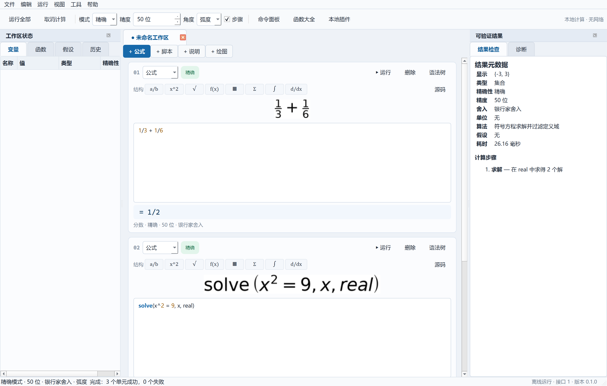

# SuperCalc / 超级计算器

SuperCalc 是一个离线优先、原生 Qt 的数学工作台，面向需要精确计算、符号推导、
矩阵、程序员工具和可复现脚本的专业用户。它不是网页或在线编辑器，运行时不启动
本地 HTTP 服务，也不需要账号、云服务或网络连接。

当前版本：**0.1.0（Windows 10/11 x64 MVP）**



## 快速启动

构建产物位于：

```text
dist/SuperCalc/SuperCalc.exe
dist/SuperCalc/SuperCalcCLI.exe
dist/SuperCalc-0.1.0-win64.zip
```

直接运行 `SuperCalc.exe` 即可。整个 `dist/SuperCalc` 目录是可移植程序，不要求安装。
如果构建机装有 Inno Setup，构建脚本还会生成 `SuperCalc-0.1.0-Setup.exe`。

从源码启动：

```powershell
uv sync --extra dev --index-url https://pypi.org/simple
uv run supercalc-gui
```

## 已实现功能

- 精确大整数、分数和精确复数；`0.1` 在精确模式下是 `1/10`，不会被浮点数冒充。
- 显式精确/近似模式、2–10000 位有效数字、六种舍入模式、近似警告和 ULP 提示。
- 化简、展开、因式分解、通分、部分分式、方程求解、导数、积分、极限、级数、
  求和与连乘。
- 精确/数值矩阵、行列式、逆、秩、LU、QR、特征值与特征向量。
- 定宽整数 `i8/i16/i32/i64/u8/u16/u32/u64`、溢出回绕警告、位运算、多进制、
  IEEE 754 binary64 位域查看、GCD/LCM、质数、模幂和组合数。
- Base64、URL、Hex、UTF-8、MD5/SHA-1/SHA-256/SHA-512、JSON、CSV、正则、
  时间戳和 ISO 时间。
- 分数、幂、根式、函数、矩阵模板和实时 MathText 排版预览；高级语法可切换线性源码。
- 顶部函数大全按分类搜索并插入函数模板；二维绘图支持显式、极坐标和隐式方程曲线。
- 多行工作区、公式/脚本/Markdown/2D 绘图单元、变量/函数/假设/历史侧栏、
  命令面板、诊断定位、文本撤销重做、拖拽打开、最近文件和崩溃恢复。
- 本地 `.scws` JSON 工作区，保存精度、模式、假设、随机种子、单元和历史。
- 自定义数学 DSL 脚本，带步数、时间、递归和集合大小限制；支持条件和循环断言。
- 本地 `.scplugin` 插件，权限提示、SHA-256 内容确认和数学 DSL 沙箱。
- CLI、GUI 和独立 worker 进程共用 `supercalc_core`；重计算可取消并超时终止。
- LaTeX、Markdown、JSON、CSV、PDF、PNG/SVG 导出，打印和系统剪贴板。

## 精确性示例

```text
1/3 + 1/6
= 1/2                      精确

# 将模式设为近似后
0.1 + 0.2
≈ 0.29999999999999998889…   近似 · 50 位 · half_even
SC3001: 十进制字面量已转换为二进制近似值
```

近似值、所用精度、舍入模式和误差提示始终随结果显示。无法求解或不在 MVP 范围内的
问题会给出结构化诊断，不会生成未经验证的数学结论。

## CLI

```powershell
SuperCalcCLI.exe eval "1/3 + 1/6"
SuperCalcCLI.exe eval "0.1 + 0.2" --mode approx --json
SuperCalcCLI.exe eval "solve(x^2 = 9, x, real)"
SuperCalcCLI.exe eval "f(n) := n <= 1 ? 1 : n * f(n-1); assert f(10) == 3628800" --script
SuperCalcCLI.exe ieee 0.1
SuperCalcCLI.exe ast "diff(sin(x)*x^2, x)"
SuperCalcCLI.exe run examples/acceptance.scws --json
SuperCalcCLI.exe test examples/assertions.scscript
SuperCalcCLI.exe export examples/acceptance.scws --format latex --output formulas.tex
```

命令输出人类可读结果；`--json` 使用版本化 `apiVersion: 1` envelope，适合嵌入和自动化。

## 构建与测试

构建机需要 Windows、`uv`、Python 3.13 和网络环境仅用于首次安装固定依赖。产物本身
运行时完全离线。

```powershell
.\scripts\build_windows.ps1
.\scripts\smoke_packaged.ps1
```

构建脚本依次执行 Ruff、Mypy、Pytest、PyInstaller、打包后 CLI/GUI 冒烟、便携 ZIP；
若 `iscc.exe` 可用，还会生成安装器。测试结果写入 `artifacts/test-results.xml`。

## 文档

- [架构与数据流](docs/architecture.md)
- [语言、类型和精度模型](docs/language.md)
- [工作区文件格式](docs/workspace-format.md)
- [安全模型](docs/security.md)
- [界面与按钮说明](docs/interface-guide.md)
- [内置函数参考](docs/function-reference.md)
- [脚本编写指南](docs/scripting-guide.md)
- [测试报告](docs/test-report.md)
- [已知限制与路线图](docs/roadmap.md)

## 隐私

程序不包含遥测、账号、云同步或网络请求代码，不启动本地监听端口。设置、恢复副本和
最近文件只保存在本机应用数据目录。插件不会加载原生二进制，也不会自动下载更新。

